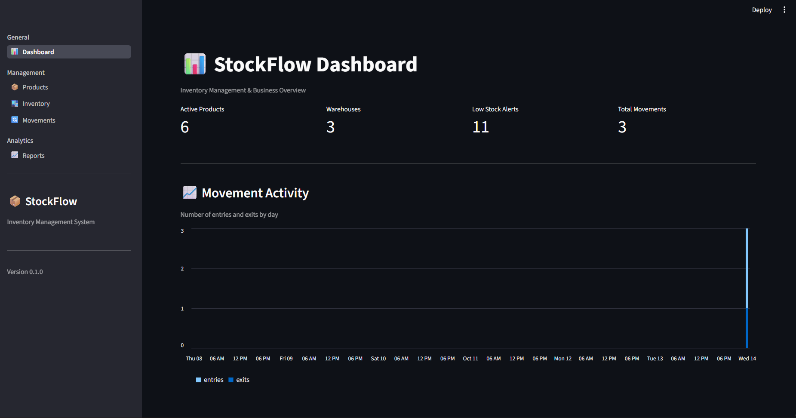
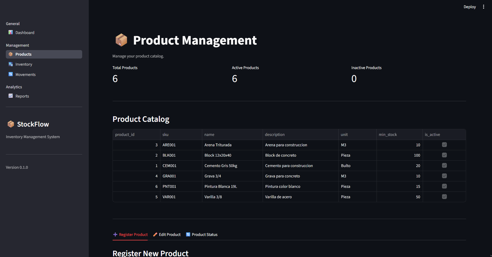
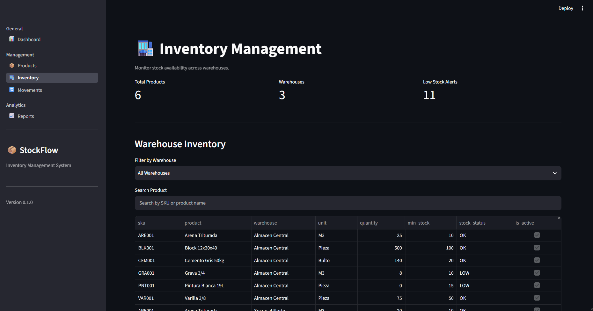
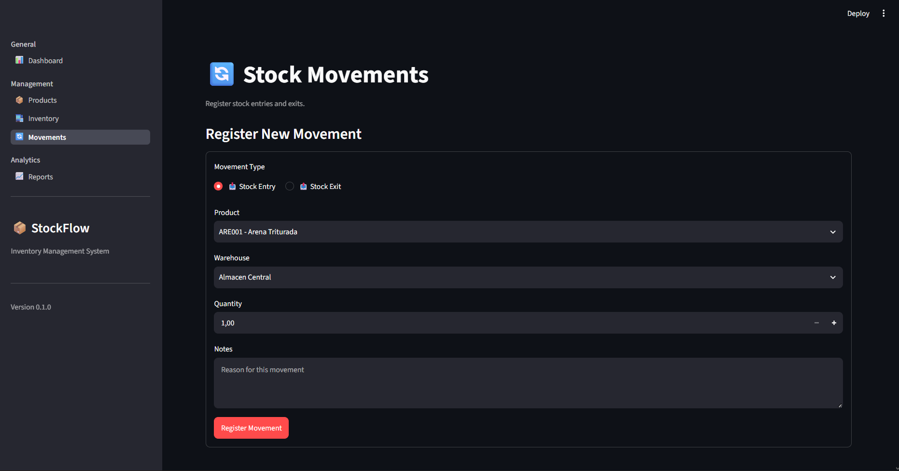
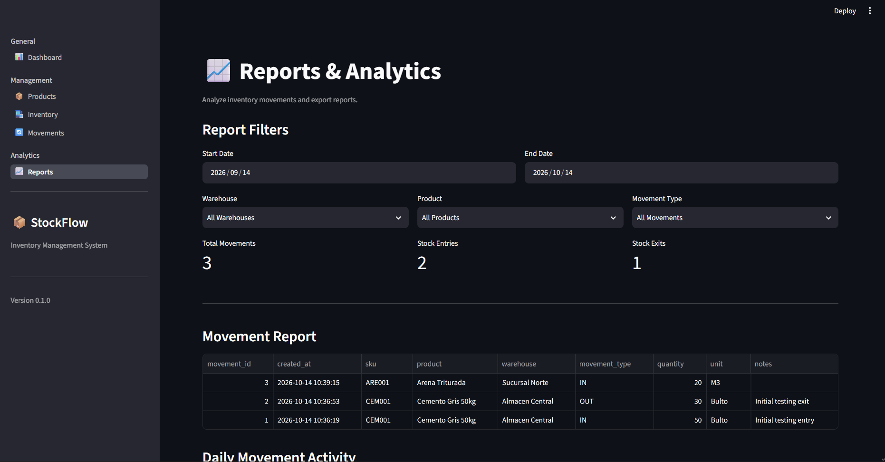

# 📦 StockFlow

### Inventory Management & Analytics System

A multi-page inventory management application built with **Python, PostgreSQL, and Streamlit**.

StockFlow helps small businesses manage product catalogs, monitor inventory across multiple warehouses, register stock movements, and analyze operational activity through interactive dashboards.

**Project Type:** Personal Software Engineering Portfolio Project  
**Status:** Functional MVP — Local Development  
**Version:** 0.1.0

---

## Application Preview

### Dashboard

An overview of inventory operations, including key performance indicators, daily movement activity, recent transactions, and low-stock alerts.



### Product Management

Manage the product catalog with create, read, update, and logical deletion functionality.



### Inventory Management

Monitor product availability across warehouses, filter inventory records, and identify low-stock products.



### Stock Movements

Register inventory entries and exits with stock validation, transaction handling, and movement history.



### Reports & Analytics

Analyze inventory movements using date, warehouse, product, and movement-type filters. Export filtered results to CSV.



---

## Key Features

- **Product CRUD:** Create, view, update, activate, and deactivate products.
- **Multi-Warehouse Inventory:** Track stock levels across different warehouse locations.
- **Inventory Transactions:** Register stock entries and exits while preventing negative inventory.
- **Movement History:** Maintain records of inventory operations.
- **Interactive Dashboard:** Display operational metrics, movement activity, and stock alerts.
- **Analytical Reports:** Filter transactions and export reports to CSV.
- **Automated Testing:** Validate inventory operations and transaction rollback behavior with Pytest.

## Technology Stack

| Technology | Purpose |
|---|---|
| Python | Business logic and data processing |
| PostgreSQL | Relational database management |
| Psycopg 3 | Python–PostgreSQL connection |
| Streamlit | Multi-page web interface |
| Pandas | Data analysis and reporting |
| Pytest | Automated integration testing |
| Git & GitHub | Version control and source hosting |

## Project Architecture

The project separates presentation, database operations, and automated tests.

```text
stockflow/
├── app.py
├── database/
│   ├── db.py
│   ├── products.py
│   ├── inventory.py
│   ├── movements.py
│   ├── dashboard.py
│   ├── reports.py
│   ├── schema.sql
│   └── seed.sql
├── views/
│   ├── dashboard.py
│   ├── products.py
│   ├── inventory.py
│   ├── movements.py
│   └── reports.py
├── tests/
│   ├── conftest.py
│   └── test_movements.py
├── docs/
│   └── screenshots/
├── requirements.txt
├── .env.example
└── README.md
```

**Architecture flow:**

Streamlit Interface → Python Business Logic → Psycopg → PostgreSQL

## Database Design

StockFlow uses four main PostgreSQL tables:

| Table | Description |
|---|---|
| `products` | Product information and status |
| `warehouses` | Warehouse locations |
| `inventory` | Current stock by product and warehouse |
| `stock_movements` | Inventory entry and exit history |

Primary and foreign keys maintain relationships between products, warehouses, and their inventory records.

## Installation

### Prerequisites

- Python 3.14 (development environment)
- PostgreSQL
- Git

### 1. Clone the repository

```bash
git clone https://github.com/elisaaagh/stockflow.git
cd stockflow
```

### 2. Create a virtual environment

```bash
python -m venv .venv
```

Activate the environment on Windows:

```powershell
.\.venv\Scripts\Activate.ps1
```

### 3. Install dependencies

```bash
python -m pip install -r requirements.txt
```

### 4. Set up PostgreSQL

Create a database named `stockflow_db`.

Execute `database/schema.sql` using pgAdmin or another PostgreSQL client.

Optionally, execute `database/seed.sql` once in a new database to insert sample data.

### 5. Configure environment variables

Copy `.env.example` to `.env` and configure your local PostgreSQL connection.

```dotenv
DB_HOST=localhost
DB_PORT=5432
DB_NAME=stockflow_db
DB_USER=postgres
DB_PASSWORD=YOUR_LOCAL_PASSWORD
```

Never commit real credentials.

### 6. Run StockFlow

```bash
python -m streamlit run app.py
```

Open `http://localhost:8501`.

## Automated Testing

StockFlow includes PostgreSQL integration tests covering:

- Stock entry transactions
- Stock exit transactions
- Insufficient-stock validation
- Transaction rollback after a simulated database failure

Create a separate database named `stockflow_test_db`, initialize it using `database/schema.sql`, and configure `.env.test` with the required `DB_TEST_*` variables.

Run:

```bash
python -m pytest tests/ -v
```

**Warning:** The integration tests clear data in the dedicated test database. Never execute them against a database containing important information.

## Technical Highlights

- Parameterized SQL queries
- Transaction commit and rollback handling
- Row locking during inventory updates
- Referential integrity and database constraints
- Product soft deletion
- Modular application structure
- Reusable database functions
- Automated integration testing

## Current Limitations

- Authentication and role-based authorization are not yet implemented.
- The initial inventory seed is not represented as opening-balance movements.
- Minimum stock thresholds are shared across warehouses.
- Concurrent movement scenarios require additional automated test coverage.
- The application currently requires a local PostgreSQL instance.

## Roadmap

- [x] Product management
- [x] Inventory overview
- [x] Stock entries and exits
- [x] Operational dashboard
- [x] CSV reports
- [x] Basic integration tests
- [ ] User authentication
- [ ] Warehouse transfers
- [ ] Extended automated test coverage
- [ ] Continuous integration
- [ ] Cloud deployment

## About This Project

StockFlow was developed as a personal software engineering portfolio project to demonstrate practical experience with Python, relational databases, backend development, SQL transactions, automated testing, and data visualization.

All sample business data is fictional.